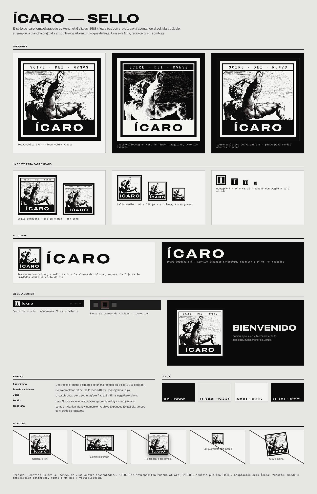

# Investigación: nuevo icono y sello de Ícaro

**Fecha:** 2026-11-03
**Estado:** exploración. El usuario eligió la dirección G1 (sello de Goltzius), pero **no aprobó todavía reemplazar el icono actual ni usar la marca en la interfaz**. Nada de esta nota cambia el ejecutable, el instalador ni las pantallas.
**Alcance:** diseño de marca. Se generaron conceptos, maestros SVG y una propuesta de `icaro.ico` en [`datos/icono-sello-2026-11-03/`](datos/icono-sello-2026-11-03/). El código, `crates/ui/assets/icono/` y la atribución vigente quedan sin cambios.

## Punto de partida

- El icono actual (`crates/ui/assets/icono/icaro-256.png` e `icaro.ico`) es un recorte de la fotografía de *La caída de Ícaro* de Blondel (CC BY 2.5). En 16-32 px la pintura no se lee.
- El [System Design](https://claude.ai/artifact/PvXuHUuhzfwkxtQThWyf9a) dice en Marca: «No hay logotipo todavía. La marca se compone en tipografía (...). No dibujar un isotipo hasta tener uno definido». Su `laminas.md` ya reserva *Ícaro* de Goltzius para el «splash de marca».

## Rondas exploradas

| Ronda | Hoja | Resultado |
| --- | --- | --- |
| 1. Grilla de píxeles 16 × 16 | [1-pixel.png](datos/icono-sello-2026-11-03/conceptos/1-pixel.png) | Ala de cera, Í de escalera y sol roto. El usuario prefirió el ala. |
| 2. Ala con más detalle, grilla 32 × 32 | [2-ala-pixel-detalle.png](datos/icono-sello-2026-11-03/conceptos/2-ala-pixel-detalle.png) | Rechazada: demasiado cuadrada; se pidió «mitología brutalista». |
| 3. Ala en relieve arcaico (curvas, sillares, escamas) | [3-ala-relieve.png](datos/icono-sello-2026-11-03/conceptos/3-ala-relieve.png) | Rechazada: muy simple, poco mítica; a veces se leía como pincel o volante. |
| 4. Figura de Ícaro en grabado detallado | [4-grabado-goltzius.png](datos/icono-sello-2026-11-03/conceptos/4-grabado-goltzius.png) | **Elegida: G1, sello de Goltzius.** G2 (Ícaro ante el sol) y G3 (la caída rompe el marco) quedan como alternativas. |

Las preferencias que fijaron la dirección fueron: figura de Ícaro como protagonista, grabado detallado y un tono mítico y monumental, no simple.

## Dirección elegida: el sello

Marco doble, el lema de la plancha original (SCIRE · DEI · MVNVS, «saber es un don de Dios»), el grabado de Ícaro que cae con el pie todavía apuntando al sol y el nombre calado en un bloque de tinta. Una sola tinta y radio cero.

Como el grabado no se lee en cualquier tamaño, se proponen tres cortes:

| Maestro | Uso propuesto | Tamaño |
| --- | --- | --- |
| [`icaro-sello.svg`](datos/icono-sello-2026-11-03/maestros/icaro-sello.svg) | Con lema. Primera ejecución, Acerca de, web | 160 px o más |
| [`icaro-sello-medio.svg`](datos/icono-sello-2026-11-03/maestros/icaro-sello-medio.svg) | Sin lema, trazo más grueso | 64 a 159 px |
| [`icaro-monograma.svg`](datos/icono-sello-2026-11-03/maestros/icaro-monograma.svg) | La Í calada en el bloque con la regla del marco | 16 a 48 px |
| [`icaro-horizontal.svg`](datos/icono-sello-2026-11-03/maestros/icaro-horizontal.svg), [`icaro-palabra.svg`](datos/icono-sello-2026-11-03/maestros/icaro-palabra.svg) | Bloqueo horizontal y palabra sola | — |

Los SVG son de una tinta (`#0d0d0d`) con todo el texto en trazados. En Tinta se pintarían con `text` del tema, lo que deja el grabado en negativo como las láminas `-negativo`; sobre fondos oscuros también sirve una «placa» con el sello en positivo sobre `surface`.

Propuesta para Windows, sin aplicar: [`propuesta-windows/icaro.ico`](datos/icono-sello-2026-11-03/propuesta-windows/icaro.ico) con las mismas 10 medidas del icono actual (16, 20, 24, 32, 40 y 48 px con el monograma; 64, 96, 128 y 256 px con el sello medio en placa) e [`icaro-256.png`](datos/icono-sello-2026-11-03/propuesta-windows/icaro-256.png) para la ventana.

## Validación realizada

- Renderizado de los SVG a 16-2048 px en Piedra y Tinta, y comparación de cada medida del `.ico` con su PNG de origen: cada medida trae su propio dibujo, no un reescalado.
- Una prueba local, ya revertida, mostró el monograma de 24 px junto a «ICARO LAUNCHER» en la barra de título: el ejemplo compiló y se capturó con `ICARO_DEMO=1` en ambos temas ([captura](datos/icono-sello-2026-11-03/propuesta-windows/barra-titulo-tinta-piedra.png)). No se ejecutaron las pruebas del launcher con ese cambio.
- No se probó el `.ico` en un Windows real (Explorador, barra de tareas, escalas de 125-150 %) ni en el instalador.

## Pendiente antes de implementar

- Aprobación del usuario para reemplazar el icono y para mostrar la marca en la interfaz.
- Actualizar la sección Marca del System Design, que hoy prohíbe un isotipo, y decidir dónde va el sello sin romper la regla de una lámina grande por pantalla: la primera ejecución y Acerca de ya muestran una lámina.
- Al aplicar: mover los maestros a `crates/ui/assets/`, actualizar `FUENTES-Y-LICENCIAS.md`, la tabla de créditos del README, `docs/creditos.md` y la mención de Blondel en `docs/instalador-windows.md`, y validar el icono en Windows.
- El sello completo pesa unos 780 KB en SVG por la densidad del buril; para la web conviene un PNG.
- No se hizo una búsqueda de marcas registradas.

## Origen y licencias

*Ícaro*, de la serie *Los cuatro deshonrados*, Hendrick Goltzius según Cornelis van Haarlem, 1588. The Metropolitan Museum of Art, 343580, dominio público (CC0, Open Access); el museo no avala a Ícaro. Adaptación: recorte de la figura y el sol, retiro del borde y la inscripción del medallón, contraste automático, umbral a un bit (150 en el sello completo; 138 con desenfoque leve y menor resolución en el medio) y vectorización con `potrace -t 3 -a 1.0 -O 0.6`. El lema y el nombre usan Martian Mono y Archivo Expanded ExtraBold (SIL OFL 1.1), convertidas a trazados.
